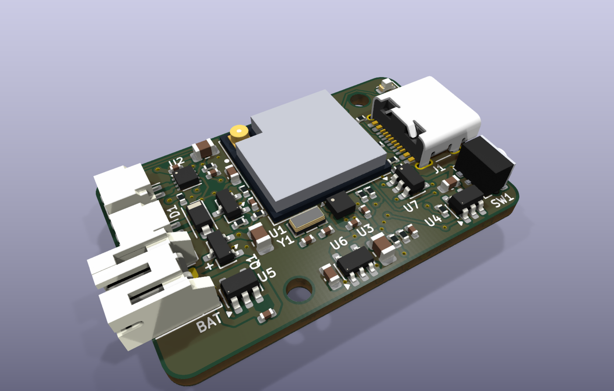
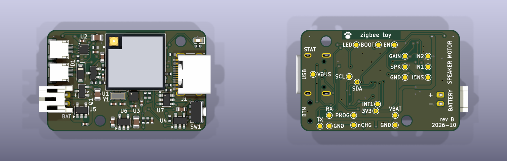

# @oddware/zigbee.cat-toy

One controller board for three battery-powered Zigbee cat toys: a flapping
bird, a flapping fish and a rolling ball. The board drives a motor and a
speaker, wakes on motion, charges over USB-C, and joins Home Assistant as a
sleepy Zigbee end device. The toys differ only in what is plugged into its
three connectors.

> This one is vibe coded: AI agents did most of the work, with me steering.
> It has never been built. There is no expectation that it works or will be
> finished; it's a side project parked here.

## Status

- **Rev A** — nRF52840 (Ebyte E73). Never built: the module and the
  accelerometer are "Standard only" parts at JLC, which put 5 assembled
  boards at about $200. Kept under the `zigbee.cat-toy/rev-a` tag.
- **Rev B** (this tree) — ESP32-C6. Every assembled part is eligible for
  JLC Economic PCBA. DRC-clean, not ordered yet.
- No firmware yet.

## The toys

| Toy | Motor | Battery | Speaker |
|-----|-------|---------|---------|
| Flappy bird | N20 gearmotor, 6 V winding, 300–400 rpm | 1S LiPo pouch, ~500 mAh | yes |
| Flappy fish | same as bird | same as bird | no |
| Rolling ball | N20 gearmotor, 6 V winding, ~100 rpm | 803040, 1000 mAh | no |

- Any 3.7 V cell with a JST-PH lead works, protected or not. The board has
  its own protection and a reverse-polarity FET; JST-PH pigtails come wired
  both ways.
- Motor and speaker plug in with JST-SH (1 mm, 1 A per pin). Crimp the
  leads or buy SH pigtails.
- Keep the ceramic capacitor across the motor tabs. It suppresses brush noise
  next to a 2.4 GHz radio.
- The module has no antenna of its own. Plug a 2.4 GHz FPC antenna into its
  u.FL socket and stick it to the inside of the toy, away from the motor and
  the cell.

Printed parts for the ball and a bench pod:
[hardware/mech/README.md](hardware/mech/README.md).

## The board

36 × 23 mm, 2 layers, every assembled part on top. Passives are 0402,
bulk capacitors 0603/0805.

| Block | Part | Notes |
|-------|------|-------|
| MCU + radio | Espressif ESP32-C6-MINI-1U-H4 | Zigbee/Thread, BLE, Wi-Fi, u.FL antenna socket. USB Serial/JTAG on the charging port |
| 3.3 V | Richtek RT9080-33 | 2 µA quiescent, 600 mA |
| Motor driver | TI DRV8213 | Current sense on IPROPI, no shunt. Firmware picks the hardware current limit per toy: 1.66 A, 324 mA or 69 mA |
| Accelerometer | MSKSEMI LIS2DW12TR-MS | Wake-on-motion and tap. Not ST's LIS2DW12, see below |
| Charger | TP4054 | 300 mA from USB-C. Charge state goes to the MCU |
| Cell protection | XySemi XB5353A | Low side, FETs built in |
| Reverse polarity | AO3401A | High side |
| Speaker | AO3400A | Low-side PWM switch |
| Status LED | red 0603 | On a GPIO |
| USB ESD | ST USBLC6-2SC6 | D+/D− clamps, VBUS-referenced |
| Button | Alps SKRTLAE010 | Side push. Pairing, and BOOT for flashing |

- Left edge — motor and speaker JST-SH connectors (SMD, assembled), battery
  JST-PH (through-hole, hand-soldered).
- Right edge — USB-C and the side-push button, status LED above the USB-C.
- Top edge — the module, 1 mm from the edge.
- Back — 21 labelled test pads, debug UART among them.

**The accelerometer is not an ST part.** MSKSEMI sells it as
"LIS2DW12TR-MS", but the pinout and register map are its own: WHO_AM_I
reads 0x11 and the registers follow the LIS2DH layout (CTRL_REG1 at 0x20,
OUT_X_L at 0x28, AOI1/CLICK blocks). Use a LIS2DH-style driver. Only INT1
is wired; route both wake and tap to it.

Schematic: [PDF](hardware/zigbee_toy/zigbee_toy_schematic.pdf).

### Pin map

| Module pin | GPIO | Net | Notes |
|---|---|---|---|
| 5 | IO2 | MOT_IPROPI | ADC1_CH2. 0.51 V = current limit reached |
| 6 | IO3 | MOT_IN1 | DRV8213 IN1 |
| 9 | IO4 | MOT_IN2 | DRV8213 IN2 |
| 19 | IO14 | MOT_GAINSEL | drive low / drive high / input (Hi-Z) |
| 10 | IO5 | SPK_PWM | speaker FET gate |
| 12, 13 | IO0, IO1 | XTAL_32K | 32.768 kHz crystal for the light-sleep clock |
| 15 | IO6 | VBAT_SENSE | ADC1_CH6, VBAT / 2 |
| 16 | IO7 | ACC_INT1 | low-power GPIO: wakes from deep sleep too |
| 22 | IO8 | I2C_SDA | 4.7 k pull-up, which also holds the IO8 strap high |
| 24 | IO18 | I2C_SCL | 4.7 k pull-up. Accelerometer at 0x19 |
| 23 | IO9 | BTN | BOOT strap. Hold while resetting for download mode |
| 25 | IO19 | VBUS_SENSE | 0.6 × VBUS: high when plugged in, charging or full |
| 26 | IO20 | CHG_STAT | low while charging, internal pull-up |
| 29 | IO23 | LED_STATUS | high = on |
| 17, 18 | IO12, IO13 | USB D−, D+ | |
| 30, 31 | RXD0, TXD0 | DBG_RX, DBG_TX | test pads, 3.3 V |
| 8 | EN | EN | 10 k / 1 µF power-on delay, test pad |

Unconnected: IO15 (a strapping pin), IO21, IO22.

Motor drive: PWM between drive and brake. Forward IN1 = 1, IN2 = 1 − duty;
reverse IN2 = 1, IN1 = 1 − duty. Both pins need a PWM channel. Drive/coast
also spins the motor, but IPROPI reads zero while coasting, so current
sensing and stall detection stop working.

### Power

Idle current is about 65 µA, nearly all of it the C6 in Zigbee light sleep
(about 54 µA, a forum figure, not measured here). The regulator, the
protection IC, the accelerometer and the battery divider add a few µA each.
That is 1.6 mAh a day. Ten minutes of flapping costs about 25 mAh, so a
500 mAh bird gets roughly three weeks per charge.

The battery divider is 1 M / 1 M. At that impedance the ADC's own input
current shifts the reading; calibrate it against a meter in firmware.

### Layout

- **Edge distance:** every assembled part body is at least 1 mm from the
  board edge (see [Ordering](#ordering)). Exempt: the USB-C and the button
  on the right edge, the two JST-SH plugs on the left. The SH fronts sit
  0.5 mm in from the edge so their solder tabs keep 0.3 mm of copper
  clearance. `gen_pcb.py` refuses a placement that breaks the rule.
- **Module position:** 1 mm from the top edge. Under it, two rows of parts
  with a channel between them: crystal, accelerometer and USB protection in
  the first row, regulator and the two dividers in the second.
- **Antenna keepout:** no copper on either layer between the module's top
  pads and the board edge. That is the area under an ESP32-C6-MINI-1's PCB
  antenna, so the MINI-1 fits the same pads. The keepout is a rule area in
  the module footprint, so DRC checks it.
- **USB D+/D−:** each USB-C pad pair is joined on the back layer through
  vias inside the receptacle. D+ passes left of the shell tab, D− right of
  it, into the USBLC6 below the receptacle. From there both run on the back
  layer under the module's bottom edge and come up through vias inside the
  pad ring at pins 17 and 18.
- **Under the USB-C:** no top-layer copper except the pad escapes. On the
  back, only the escape vias and the VBUS run, so the shell still ties into
  the ground pour.
- **Crystal:** no back-layer copper under it or its traces.
- The DSN export turns the last two into keepouts for the autorouter; hand
  routes are not checked against them.
- **VBAT:** back layer from the battery FET up the left column to the
  driver, and along the bottom in a channel between the two rows of test
  pads to the regulator, the battery divider and the charger.
- **3V3:** regulator, 22 µF next to it, 10 µF at module pin 3.
- **Motor driver:** C3's ground pad drops straight onto the thermal pad,
  which has two vias to the back. Keep the back plane under the driver
  whole: with one trace under it, C3's return path was 15 mm long instead
  of 1.
- **Ground:** both layers poured. `gen_pcb.py stitch` adds a 2.5 mm via grid
  and a via to every pour island it can reach. Five of the module's nine
  centre ground pads have a via.

## Flashing

The C6 has USB Serial/JTAG on the charging port: flashing, console and
debugging over one cable.

1. Connect the USB-C to the computer.
2. Flash with ESPHome or esptool. The tool resets the C6 into download mode
   over USB; the button is not needed.

If the firmware has disabled USB or does not respond:

1. Hold the button.
2. Connect the EN test pad to a GND pad for a moment.
3. Release the button. The C6 is in download mode.

UART0 is also on the TX and RX test pads, 3.3 V.

## Rebuilding

The schematic and the board are generated by scripts. Do not edit them in
KiCad; the next build overwrites the changes.

| To change | Edit |
|-----------|------|
| Parts and nets | `hardware/tools/design.py` |
| Board placement | `hardware/tools/placement.py` |
| Copper | `hardware/tools/routes.py` (hand routes), `routes_frozen.py` (a frozen Freerouting pass, hand-edited since) |
| Silkscreen | `hardware/tools/silk.py` |

Needs the KiCad 10 flatpak, ImageMagick, and network access the first time
a new LCSC number shows up in the BOM.

1. Run `hardware/tools/build.sh`. It writes the schematic, runs ERC, checks
   the netlist against intent, and writes the PDF and the JLC BOM.
2. Run `hardware/tools/pcb_build.sh`. It places, adds the copper, stitches,
   adds the silkscreen, runs DRC and checks part spacing
   (`check_spacing.py`: bodies 0.2 mm, pads 0.15 mm apart; the library
   courtyards overlap by their margins). Placement fails if a part breaks the
   edge distance.
3. Run `hardware/tools/export_jlc.sh`. It writes `gerbers.zip`, `cpl.csv`
   and `bom.csv` to `hardware/zigbee_toy/build/jlc/`.

To autoroute nets that have no copper yet (needs the Freerouting flatpak and
a JDK; one pass takes up to 10 minutes):

1. Run `gen_pcb.py layout`, then `gen_pcb.py dsn`.
2. Run `tools/freerouting/Route.java` on `build/zigbee_toy.dsn`.
3. Run `gen_pcb.py ses`, then `freeze_routes.py append`. The new copper
   goes into `routes_frozen.py`.

Run the Python scripts with the flatpak's interpreter
(`flatpak run --command=python3 org.kicad.kicad`). Outputs go to `build/`
folders, which git ignores.

## Ordering

- Order Economic PCBA. Nine parts are JLC "Extended" ($3 each per order):
  module, motor driver, accelerometer, regulator, protection IC, USB ESD,
  USB-C, JST-SH, button. Parts come to about $8.25 a board.
- The order's BOM step decides Economic or Standard, not the "PCBA Type"
  field on the part page. One Standard-only part moves the whole order to
  Standard. Re-check there after any part swap.
- JLC flags the module and the accelerometer for X-ray inspection. Not
  confirmed yet whether that changes the PCBA type.
- Parts sit as close as 1 mm to the edge. JLC panelizes Economic boards
  itself and routes them apart, and its Economic FAQ asks for 0.3 mm. The
  2.5 mm in the general assembly terms is for Standard PCBA, where the
  machines grip the board's own edge.
- The USB-C overhangs the board edge by 1 mm. Say so in the order remark.
- JLC places a part using the origin and rotation of *its* EasyEDA
  footprint, not KiCad's. `jlc_cpl.py` fits each KiCad footprint onto the
  EasyEDA one and corrects the CPL (the module is 0.65 mm off, the USB-C
  1.6 mm); it fails if a fit is poor. Check JLC's 3D placement preview
  anyway. The EasyEDA footprints are cached in `hardware/tools/easyeda/`.
- The FPC antenna is not on the BOM. Any 2.4 GHz FPC antenna with a u.FL
  (IPEX MHF1) lead fits.
- The ESP32-C6-MINI-1 (PCB antenna) drops onto the same pads; its antenna
  overhangs the top edge by 3.1 mm. Swap the LCSC number in `design.py` and
  mention the overhang in the order remark. As of 2026-10 every MINI-1
  listing at JLC is out of stock and Standard only.
