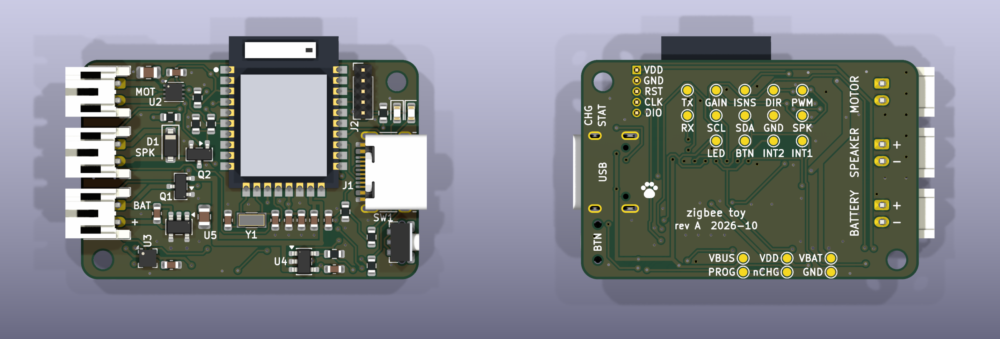
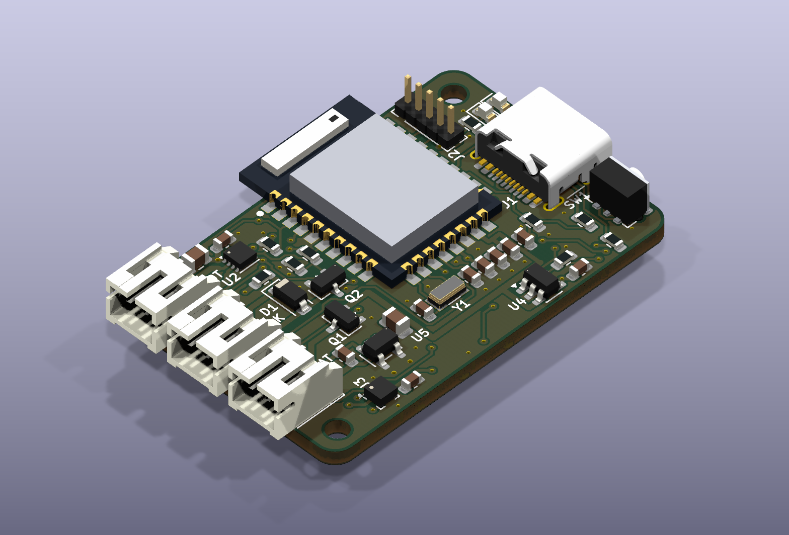

# Zigbee Cat Toy: Shared Controller Board (rev A)

All three toys use **the same assembled board**, with no jumpers. Each toy differs only in what you plug into its three JST-PH connectors (motor, speaker, battery).

| Toy | Battery | Motor (suggested) | Speaker |
|---|---|---|---|
| Flappy bird | 1S LiPo pouch, ~500 mAh | **N20 gearmotor, 6 V winding, ~300–400 rpm rated** (≈180–250 rpm, 3–4 flaps/s at 3.7 V) | yes |
| Flappy fish | 1S LiPo pouch, ~500 mAh | same as bird | leave pads empty |
| Rolling ball | 1S LiPo 803040, 1000 mAh (the only cell that fits under the axle at Ø80) | **N20 gearmotor, 6 V winding, ~100 rpm rated**; the motor body is the axle (see §10) | leave pads empty |

- **Batteries:** any 3.7 V hobby pouch with a JST‑PH lead, **protected or unprotected**. The board has its own protection, and in series with the cell's PCM that's harmless (see 2.5).
- **130 motor vs N20 trade-off:**
  - A bare 130 runs ~8–12k rpm at 3.7 V, and flapping wants ~120–300 rpm, so it needs a ~40–80:1 reduction. One printed worm stage (~20–40:1) plus a spur stage does it, the same way the commercial toys work.
  - The 130 is about $0.20 and draws ~150–250 mA at no load. The N20 is about $2, draws ~40–80 mA and has its gearbox built in.
  - The board handles either: GAINSEL Low gives a 1.66 A limit, which suits the 130.
  - **Decision: N20 for all three.** The ball first looked like a TT-motor job (double shaft = axle), but the printed ball in §10 uses an N20 lying on the pole axis as the axle, with a 100 rpm gearbox so the pendulum can be lifted over the top at low duty.
    The N20 costs a few dollars more per toy but is quieter, more efficient and lighter (motor + gearbox ~10 g, vs ~30 g for a 130 + printed gearbox), with metal gears that survive cats. There's also no gearbox to design.
  - Pick the 6 V winding: at 3.7 V it runs gentler, draws less current and has more stall margin. GAINSEL Hi‑Z (324 mA limit) protects its brass gears.
  - Measure actual consumption with IPROPI and log it as a mAh counter.
- **Motors:** the cheap brushed motors with a ceramic cap across the tabs. **Keep that cap**: it suppresses brush noise right next to a 2.4 GHz radio.

---

## 1. Block diagram

```
 USB-C 5V ─┬──────────────────────────────────────► nRF52840 VBUS (USB DFU/console, plug detect)
           │  D+/D- ────────────────────────────────► nRF52840 USB
           └─► TP4054 (300 mA) ──┐  CHRG ─► charge LED
                                 │
 CELL+ ──► Q1 P-FET (reverse-polarity) ──► VBAT ──┬─────► nRF VDDH ──REG0──► VDD 3.0 V ─► LIS2DH12, LED, I/O
                                                  ├─────► DRV8213 VM ──► MOTOR (IPROPI ─► SAADC, GAINSEL ◄─ GPIO)
                                                  └─────► SPEAKER ─► Q2 N-FET (PWM)
 CELL- ──► U5 XB5353A (protection IC, integrated 54 mΩ FETs) ──► GND
```

---

## 2. Key decisions and rationale

### 2.1 Radio/MCU: nRF52840 in an Ebyte **E73‑2G4M08S1C** module (LCSC C356849, $7.67)

**Why nRF52840**
- Nordic's current Zigbee stack, the Zigbee R23 add-on v1.3.0, is production-ready on nRF52840 and nRF54L15/L10/L05.
- The **nRF52833 is supported only as an NCP**, so it can't run the toy on its own.

**Why a module, not a bare chip**
- The bare nRF52840 only comes as aQFN‑73 or WLCSP.
- A bare nRF54L15 ($3.39) would need about 4–5 extra *extended* JLC parts: 32 MHz crystal, RF matching, antenna and an LDO. Each adds a $3 fee per order.
- At 3–5 boards the module is cheaper overall and avoids antenna tuning.

**What the nRF52840 gives this board**
- **VDDH (2.5–5.5 V)** takes the LiPo directly. The internal REG0 makes VDD, so there's no external regulator and no quiescent cost.
- **Battery voltage comes from the SAADC's internal VDDH/5 input**, with no divider, no fuel gauge and no leakage.
- **Native USB:** after one SWD flash of a USB bootloader, you reflash over the charging port.
- Zigbee and BLE can run concurrently (phone setup or BLE OTA as a fallback).

**Module notes**
- Pins confirmed from the Ebyte datasheet: VDH = VDDH (pin 23), DCH = DCCH (25), VBS = VBUS (27), D−/D+ (29/31), VCC = VDD (19).
- **There's no 32.768 kHz crystal on the module**, so we add Y1.
- Don't buy the "‑CX" version: it has an IPEX connector instead of the ceramic antenna.

### 2.2 Motor driver: TI **DRV8213DSGR** (LCSC C22407186, $1.04)

- 1.65–11 V, 4 A peak. Auto-sleeps at **20 nA** when IN1 = IN2 = 0.
- **IPROPI** outputs a current proportional to motor current, with no shunt. We read it on the SAADC (AIN1, P0.03) for stall detection: cat pinning a wing, ball wedged under the sofa.
- **Hardware current limit:** the bridge chops when V(IPROPI) reaches 510 mV. It caps torque and protects printed gears even if the firmware hangs.
- **GAINSEL (tri-level) is wired to a GPIO**, so firmware picks the range per toy. With **R6 = 1.5 kΩ**:

| GAINSEL (GPIO state) | Gain | Hardware current limit | OCP | Use |
|---|---|---|---|---|
| Low (drive 0) | 205 µA/A | **1.66 A** | 4 A | TT / 130 motors (stall ≈ 1–1.5 A at 3.7 V) |
| Hi‑Z (input, disconnected) | 1050 µA/A | **324 mA** | 0.8 A | N20 gearmotors: a soft torque limit for printed gears |
| High (drive 1) | 4900 µA/A | **69 mA** | 0.16 A | gentle / test mode |

- The IPROPI voltage stays ≤ 0.51 V, so the SAADC uses the 0.6 V internal reference at gain 1 for full resolution.
- Sample IPROPI in the middle of the PWM period, or average it, because the motor's tab cap causes current spikes at the switching edges.
- PWM at ~20 kHz (inaudible).

### 2.3 Accelerometer (wake source): ST **LIS2DH12TR** (LCSC C110926, $0.93)

- About 2–3 µA in low-power mode at 1–10 Hz, with wake-on-motion on INT1 and click/orientation on INT2.
- Zephyr has a mainline driver (`st,lis2dh`).
- Also usable for behaviour: ball flipped, bird picked up, double-tap to play.

### 2.4 Charger: **TP4054** (TOPPOWER, LCSC C32574)

- It's a *preferred* extended part, so there's no fee.
- CC/CV to 4.2 V, with a 1/10-current trickle below 2.9 V. I_BAT = 1000 / R_PROG, so **R3 = 3.3 kΩ gives ≈300 mA**:
  - about 0.6 C for a 500 mAh cell (~2 h charge);
  - about 0.3 C for a 1000 mAh cell (~4 h).
  - The chip dissipates about 0.4 W from 5 V at that current. Inside a closed shell it may enter thermal regulation and taper the current, which is safe and only slows charging a little.
- CHRG drives a red LED from VBUS, so it works even when the cell is too flat to run the MCU.
- Firmware knows a cable is plugged in from the nRF52840's own USBDETECTED event. While on the charger it blocks the motor and reports "charging".

### 2.5 Battery protection: **XySemi XB5353A** (U5, LCSC C80628, $0.088, extended), low side

A single SOT‑23‑5 with the FETs built in. The only external part is C15 (100 nF). Datasheet: [XB5353A on JLC/LCSC](https://jlcpcb.com/partdetail/C80628).

| | |
|---|---|
| Over-charge | 4.30 V detect / 4.10 V release |
| Over-discharge | 2.40 V detect / 3.0 V release (needs the charger) |
| Over-current | **3 A typ (2.1 A min)**, 10 ms delay. That's above the DRV8213's 1.66 A ceiling, so normal stalls never trip it. |
| Short circuit | 20 A, 75 µs |
| FET resistance | 54 mΩ typ / 63 mΩ max. At a 1.66 A stall that's 0.15 W, well under the 0.4 W package rating. |
| Supply current | 2.8 µA typ in operation, 1.5 µA in power-down |
| Extras | cell-reverse and charger-reverse protection, 0 V battery charging, 120 °C over-temperature |

- **Two PCMs in series** (cell + board) just add about 50–60 mΩ. Whichever trips first wins and the other stays on, so protected and unprotected cells both work.
- **Wiring:**
  - VDD = CELL+, with C15 right at the pins.
  - GND = CELL−.
  - VM (pins 4 and 5) = board GND (P−).
  - Pin 1 (VT, test) is left unconnected.
  - The bold current path CELL− → GND → VM → P− is a short, wide pour.
- **First connection:** per the datasheet, the IC may come up in protect mode the first time a cell is attached. Plug in USB once to wake it. Same as a DW01.
- **Alternative considered:** DW01A + HJ8205 (preferred part, no fee). It has the same fee count and 2 µA lower standby, but uses 4 more parts.

### 2.6 Reverse polarity: AO3401A P‑FET (Q1, basic part)

- JST‑PH pigtails really do come wired both ways, depending on the seller.
- Q1 has its gate to GND and costs almost nothing in voltage drop (~20 mV at 300 mA).
- On power-up Q1 conducts through its body diode until the XB5353A closes its FETs, then turns fully on.
- **Reversed cell:** Q1 blocks the high side, and the XB5353A blocks the low side and is rated for a reversed cell.
- Charge current flows backward through Q1's switched-on channel, which is fine for a MOSFET.

### 2.7 USB‑C: HRO **TYPE‑C‑31‑M‑12** (LCSC C165948)

- CC1 and CC2 each have 5.1 kΩ to GND (5 V sink). USB2 D+/D− go straight to the nRF52840.
- No ESD array. Add a USBLC6‑2SC6 later if the port ends up exposed through the shell.
- There's no basic or preferred USB‑C receptacle at JLC, so this one fee is unavoidable.

### 2.8 Speaker: PWM low-side MOSFET (only basic parts)

- AO3400A (Q2) switches the speaker. A B5819W diode across the speaker clamps flyback.
- The nRF PWM peripheral plays 8-bit PCM by DMA (~16 kHz audio on a 62.5 kHz carrier), and the speaker coil filters it. Plenty for chirps.
- R11 is a 0 Ω link (0603, 1 A). For an 8 Ω speaker, cap the PWM duty in firmware. A series resistor here would need ≥0.25 W, more than an 0603 or 0805 can take.
- Fitted on every board for a few cents. The fish and ball just leave the pads empty.

### 2.9 Battery state of charge, done in firmware

- SAADC input `VDDHDIV5`, internal 0.6 V reference, gain 1/2: 0–6 V range.
- Take an open-circuit reading ≥30 s after the motor stops and look it up in a LiPo OCV table (4.20 V = 100 %, ~3.40 V = 0 % for our purposes).
- A second reading under motor load gives internal resistance, which flags an aging cell.
- Firmware cutoff: no motor below 3.4 V at rest. The XB5353A at 2.4 V is the last line of defence.
- Reported through the Zigbee **Power Configuration** cluster (`BatteryVoltage`, `BatteryPercentageRemaining`). Zigbee2MQTT and ZHA show it with no custom code.

---

## 3. Power budget

### Sleep (armed: Zigbee sleepy end device, accelerometer watching)

| Item | Current |
|---|---|
| nRF52840 System ON, RTC on LFXO, RAM retained | ~2–3 µA |
| Zigbee data poll every 30 s (~5 ms at ~6 mA each) | ~1 µA |
| LIS2DH12, low-power 10 Hz, wake interrupt | ~3 µA |
| XB5353A | 2.8 µA |
| TP4054 battery leakage, no VBUS | ≤1–2 µA |
| DRV8213 sleep | 0.02 µA |
| **Total** | **~10–12 µA** |

That's over 4 years of standby on 500 mAh, so the cell's self-discharge dominates.

### Active

| Toy | Draw | Run time per charge |
|---|---|---|
| Bird / fish, N20 at ~100–200 mA | ~150 mA | ~3 h of flapping on 500 mAh, ≈500 bursts of 20 s |
| Ball, TT at ~250–400 mA rolling | ~300 mA | ~3 h on 1000 mAh |

- Quiet hours and stall cut-off are what actually protect battery life.
- Start/stop from Home Assistant arrives on the next Zigbee poll, ≤30 s.

---

## 4. Pin map (E73 module pin → nRF pin → net)

The module is rotated 180° with its antenna on the top board edge. Each pin was chosen so its signal leaves on the side where its circuit sits, with no crossings. PWM signals stay on full-speed pins; the left-edge pins (near the radio) only carry slow or analog signals.

| Module pin | nRF | Net | Notes |
|---|---|---|---|
| **left edge** | | | |
| 3  | P0.03 / AIN1 | MOT_IPROPI | motor current sense; R6 1.5 kΩ to GND |
| 4  | P0.28 | MOT_GAINSEL | drive 0 / drive 1 / disconnected = Hi‑Z |
| 6  | P1.13 | MOT_DIR | DRV8213 IN1, static direction |
| 5  | GND | GND | |
| **bottom edge** | | | |
| 11 / 13 | XL1 / XL2 | 32.768 kHz | Y1 + C12/C13 20 pF |
| 15 | P0.05 | MOT_PWM | DRV8213 IN2, ~20 kHz PWM |
| 17 | P1.09 | SPK_PWM | speaker FET gate, PWM sample playback |
| 19 | VDD | VDD | C9 100 nF + C8 4.7 µF |
| 21 | GND | GND | |
| 23 | VDDH | VBAT | C7 100 nF + C6 4.7 µF |
| 25 | DCCH | — | NC: REG0 runs as an LDO |
| **inner bottom row** (escaped through a via) | | | |
| 12 | P0.26 | ACC_INT1 | wake-on-motion |
| 14 | P0.06 | I2C_SDA | internal pull-ups (~13 kΩ), 100 kHz |
| 16 | P0.08 | I2C_SCL | |
| 18 | P0.04 | ACC_INT2 | click / orientation |
| 20 | P0.12 | LED_STATUS | R5 1 kΩ, status LED D3 |
| 22 | P0.07 | BTN | side-push pairing button SW1, internal pull-up |
| 24 | GND | GND | |
| **right edge** | | | |
| 29 / 31 | D− / D+ | USB_DN / USB_DP | straight across to the USB-C |
| 27 | VBUS | VBUS | |
| 26 | P0.18 / RESET | nRESET | SWD header |
| 37 / 39 | SWDIO / SWCLK | SWD | J2: 5-pad 1.27 mm header, unpopulated |
| **inner right row** (escaped through a via) | | | |
| 28 | P0.15 | DBG_TX | debug UART out, test pad TX (back) |
| 30 | P0.17 | DBG_RX | debug UART in, test pad RX (back) |

**Motor drive (DIR + PWM).** Only one pin needs fast PWM:
- forward: DIR = 0, PWM = duty
- reverse: DIR = 1, PWM = 1 − duty

**Unused:** 1, 2, 7–10, 32–43 except those listed above.

**Debug UART.** P0.15/P0.17 go only to back test pads. Any 3.3 V USB-serial adapter (TX→RX, RX→TX, GND) gets the Zephyr console. It keeps working when USB is unplugged, the radio is busy, or the firmware has crashed before USB comes up: exactly when the CDC console is no help.

## 5. Circuit details per block

**Battery and protection**
- CELL+ pad / J3 pin 1 → Q1 drain. Q1 source = **VBAT**. Q1 gate → GND.
- CELL− pad / J3 pin 2 → U5 XB5353A GND (pin 2).
- U5: VDD (pin 3) ← CELL+, with C15 100 nF to CELL−. VM (pins 4 and 5) → board GND. VT (pin 1) NC.
- C1 22 µF on VBAT.
- J3 is a JST S2B‑PH‑K‑S, through-hole, hand-soldered (not JLC-assembled). Bare wires also fit its holes. **Silkscreen: "+" pin 1.**

**Charger**
- VBUS → TP4054 VCC, with C4 4.7 µF.
- PROG → R3 3.3 kΩ → GND.
- BAT → VBAT.
- CHRG → D2 red → R4 1 kΩ → VBUS.

**USB‑C**
- VBUS pins → VBUS. CC1 → R1 5.1 kΩ → GND. CC2 → R2 5.1 kΩ → GND.
- D+/D− (both rows joined) → module. Shell → GND.

**nRF52840 power**
- VBAT → VDDH, with C6/C7.
- VDD: C8/C9.
- Firmware sets `UICR.REGOUT0 = 3V0` on first boot. The erased default is 1.8 V, which still works with every part on the board (LIS2DH12 ≥ 1.71 V, DRV8213 V_IH = 1.45 V).

**Motor**
- DRV8213 VM = VBAT, with C2 10 µF + C3 100 nF right at the pins.
- OUT1/OUT2 → MOT+/MOT− pads.
- IPROPI → R6 1.5 kΩ → GND, and → AIN1 (P0.03).

**Speaker**
- SPK+ pad → R11 → VBAT. SPK− pad → Q2 drain.
- D1: cathode at SPK+, anode at SPK−.
- Q2 gate ← R7 ← SPK_PWM, with R8 to GND.

**Accelerometer**
- VDD and VDD_IO → VDD, with C10 100 nF (the module's 4.7 µF C8 is on the same rail).
- CS → VDD (selects I²C). SA0 → VDD (address 0x19); SA0 has an internal pull-up, so tying it to VDD costs no current.
- No external I²C pull-ups: the nRF52840's internal ~13 kΩ pull-ups are enough for a 1 cm bus at 100 kHz.

**UI**
- D3 status LED: GPIO → R5 → LED → GND.
- SW1 → GND.

**Layout targets** (next step)
- See section 9 for the final layout.
- The module's antenna end goes at the board edge, with no copper under it on any layer.
- Motor, speaker and battery current loops sit at the far end from the antenna.

---

## 6. Cost (JLC economic PCBA, 5 boards, 2-layer)

| | |
|---|---|
| Parts per board (qty 1–9 pricing) | ~$11.00 (the module is $7.67 of that) |
| Extended-part fees: E73, DRV8213, LIS2DH12, USB‑C, XB5353A, SKRTLAE010 at $3 each (TP4054 is preferred, so free) | $18 |
| Setup + stencil + PCB | ~$12 |
| **About $85 for 5 assembled boards (~$17 each) + shipping** | |

**At volume** (rough, from JLC's published fee table and part pages, 2026-10):
- **100 boards:** about $9–10.5 a board on JLC Standard PCBA. The board must be panelized, since single boards must be at least 70 × 70 mm.
- **1000 boards:** about $7.7–9.3 a board.
- The E73 module is 65–80% of the price at every quantity: about $7.09 on JLC, maybe $5.5 at LCSC 100+, with little stock.
- Fees and labour fall below $0.10 and $0.30 a board, so a cheaper assembler can't save much. Only a cheaper module does.
- PCBWay doesn't publish its assembly pricing. Estimates put it at or above JLC, unless its quote beats the module price.
- A bare nRF52840 would save only $0.6–2.2 a board. It would cost 4 layers, RF tuning and your own radio certification ($5–15k), so it isn't worth it at 1k.

**Passives:** 12 line items, all JLC Basic, all 0603 except the 22 µF and 10 µF bulk caps (0805, for DC-bias derating). Each value is chosen for its job. Merging values would save almost nothing at JLC, because Basic parts carry no per-line fee, and it would cost charge speed and LED brightness.

Hand-soldered extras: JST‑PH connector, battery, motor, speaker. Order these from LCSC alongside the boards, or use AliExpress.

---

## 7. Still open
- **Zigbee coordinator:** Zigbee2MQTT or ZHA? This affects how quiet-hours, intensity and sound settings are exposed. It's a firmware-phase question.
- **Motor choice** is final only after the mechanical design. The board handles N20 and TT/130 motors through GAINSEL with no hardware change.

Sources:
- [Zigbee R23 add-on supported SoCs](https://nrfconnectdocs.nordicsemi.com/addons/zigbee-r23/latest/setup.html) and [release notes](https://nrfconnectdocs.nordicsemi.com/addons/zigbee-r23/latest/release-notes.html)
- [DRV8213 datasheet](https://www.ti.com/lit/gpn/drv8213)
- [E73-2G4M08S1C (LCSC)](https://lcsc.com/product-detail/C356849.html)
- TP4054 I = 1000/R_PROG: [HP4054 datasheet](https://wmsc.lcsc.com/wmsc/upload/file/pdf/v2/lcsc/2006301234_HYPWR-HP4054S5-42_C648904.pdf) and [TP4054 notes](https://en.ovcharov.me/2025/01/08/tp4054-current-limiting-resistor-values/)
- Prices and stock were pulled live from the JLCPCB parts API on 2026-10-19.

---

## 8. Schematic and project files

| Path | What |
|---|---|
| `hardware/zigbee_toy/zigbee_toy.kicad_pro` / `.kicad_sch` | KiCad 10 project + single-sheet A3 schematic |
| `hardware/zigbee_toy/zigbee_toy_schematic.pdf` | rendered schematic |
| `hardware/zigbee_toy/jlc_bom.csv` | JLC upload BOM, exported from the schematic's `LCSC` fields (DNP and hand-soldered parts excluded) |
| `hardware/zigbee_toy/zigbee_toy.kicad_sym` | project symbols: E73, DRV8213DSG, XB5353A, TP4054, LIS2DH12 |
| `hardware/zigbee_toy/zigbee_toy.pretty/Ebyte_E73-2G4M08S1C` | module footprint, built from LCSC's EasyEDA data for C356849, with an antenna copper keepout |
| `hardware/tools/` | generators (`design.py` holds placement + nets) and `build.sh` |
| `hardware/tools/export_jlc.sh` | JLC order files → `hardware/zigbee_toy/build/jlc/`: `gerbers.zip` (Gerber + Excellon, zones refilled first), `cpl.csv` (placement in JLC's footprint frame via `tools/jlc_cpl.py`, only the refs in `jlc_bom.csv`), `bom.csv`. Run it after `pcb_build.sh`. |
| `hardware/mech/pod.py`, `pod.sh` | Printed electronics pod (cradle with faceplate, lid, battery box), FreeCAD headless, with a collision check against the board STEP. Superseded for the ball by `ball.py`; kept for a bench unit. See `hardware/mech/README.md`. |
| `hardware/mech/ball.py`, `ball.sh`, `ball_view.scad` | Printed rolling ball: two threaded domes, tail ring, closed electronics core (cup + cap with the USB-C window and the pairing pinhole), chassis, battery tray. `ball.sh --check` builds STEP/STL into `hardware/mech/build/ball_803040/` and checks every part against the board STEP. See `hardware/mech/README.md`. |

**The schematic is generated.**
- Change `hardware/tools/design.py`, then run `hardware/tools/build.sh`.
- `build.sh` regenerates the files, runs KiCad ERC with violations treated as failures, and diffs KiCad's netlist against the intended one.
- Every pin connects through a short stub and a net label. Every unused pin has an explicit no-connect flag.

**Pinouts and where they were checked**

| Part | Pinout source |
|---|---|
| E73 | Ebyte datasheet pin table |
| DRV8213 DSG | TI datasheet, Table 6‑1 |
| XB5353A | XySemi datasheet |
| TP4054 | AOTE and TP4054‑TD datasheets (both: 1 CHRG, 2 GND, 3 BAT, 4 VCC, 5 PROG) |
| LIS2DH12 | ST datasheet, Table 2 |


---

## 9. PCB layout (rev A)



*KiCad 3D render. Left: top. Right: bottom, as seen from below.*



**Board**
- **40 × 26 mm** (integer, for the shell CAD), 2-layer, 1.6 mm. All SMD parts on top, for JLC economic PCBA; only bare test pads on the back.
- Overhangs, for the shell:
  - the module antenna, 2.8 mm past the top edge (envelope 40 × 28.8 mm);
  - the **USB-C receptacle face, exactly 1.0 mm past the right edge**, so it sits flush with a 1 mm shell wall's outer face;
  - the three JST housings, about 2.4 mm past the left edge.
- SW1's plunger tip is at the board edge, so behind a 1 mm wall it sits about 0.9 mm recessed. The shell needs either a Ø2.5 mm poke hole or a printed flexure key that reaches in.
- Two M2 mounting holes (NPTH) in diagonal corners, top-right and bottom-left. That is the widest spacing the board allows, and it still stops the board rotating. The top-left corner belongs to the motor JST.
  - Sized for **ISO 7380 button-head** screws (3.5 mm head). Their smaller keepout is what lets the bottom-left hole tuck under the battery JST. A cheese or pan head (3.8–4 mm) would touch the JST housing.

**Floorplan: each edge has a job**

| Edge | Contents |
|---|---|
| Top | Module antenna, **hanging 2.8 mm past the edge**: no FR4 or copper under the ceramic antenna, which is the layout Ebyte and chip-antenna vendors prefer. The castellated pads stay 0.7 mm inside the edge. |
| Left (internal wiring) | Three identical side-entry **JST-PH S2B-PH-K-S** connectors: motor J4, speaker J5, battery J3. The connectors stack from the top-left corner, and the housings overhang the edge by about 2.4 mm. Each connector's circuit sits right beside it: DRV8213, speaker FET, and XB5353A + reverse FET. |
| Right (reachable through the shell) | From the top: the status (D3) and charge (D2) LEDs with the CC2 resistor beside them, then **USB-C** J1, then the side-push pairing button **SW1** (Alps SKRTLAE010) with its plunger flush to the edge. The LEDs sit above the USB-C so the button never shades them. Their 1 kΩ resistors stay in the bottom-right pocket. |
| Under the module | Crystal and module decoupling in a single row. |
| Bottom band | VBAT trunk running east-west directly under the decoupling row. Below it: the accelerometer (left, beside the bottom-left hole) and the charger with its PROG resistor and VBUS cap (centre-right). |

**Copper**
- Hand-routed (`hardware/tools/routes.py`):
  - the battery → protection → reverse FET → VBAT trunk, 0.5–0.8 mm wide;
  - the short bottom-layer hop up to the motor driver;
  - motor and speaker outputs;
  - the crystal;
  - module decoupling;
  - all module inner-row escapes;
  - VBUS, which goes over the bottom layer: the USB pad row is too dense to cross at 45°;
  - CC2, which leaves its pad to the right and runs under the receptacle on the bottom layer up to R2. D+/D− box it in on the left.
- The remaining low-current signals and the test pad links were autorouted once (Freerouting, 0/45/90° only) and then **frozen** into `hardware/tools/routes_frozen.py`. From now on all copper is hand-owned, and a board rebuild takes seconds, not 10+ minutes. While autorouting, it kept:
  - no top-layer tracks under the module body;
  - no bottom-layer tracks under the USB-C;
  - a 0.5 mm no-track frame around the board edge.
  - To autoroute again: `gen_pcb.py dsn`, then `tools/freerouting/Route.java`, then `gen_pcb.py ses`.
- Known wart: SPK_PWM takes a long front-side detour round the left edge, because the motor block is dense. It's harmless at a 62.5 kHz gate drive behind 100 Ω, but it's the first thing to tidy if the area is ever reworked.
- Ground pours on both layers, 0.18 mm clearance so the pour squeezes between the back-side test pad traces. SMD pads connect solid; through-hole pads use thermal reliefs (the USB shell connects solid). Stitching vias on a 2.5 mm grid, plus a check that every pour fragment is tied into the main ground (islands get their own via; one hand via drops R8's pocket through to the back).

**Silkscreen** (`hardware/tools/silk.py`, applied by `gen_silk.py`)
- Front:
  - Function names next to the JSTs: **MOT**, **SPK**, **BAT**, plus **+** at the battery's pin 1. The housings cover the edge, so the labels sit just inboard of them.
  - Reference designators for the parts you'd probe while debugging: ICs, FETs, diodes/LEDs, crystal, J1/J2, SW1. They're auto-placed clear of pads, vias, component bodies (F.Fab outlines) and each other.
  - Passive refs go on F.Fab only, as an assembly drawing.
- Back (nearly empty, so it carries the readable legend):
  - title "zigbee toy · rev A 2026-10" and a paw print, in the antenna keepout;
  - MOTOR / SPEAKER / BATTERY with +/− at the pins;
  - SWD pinout beside J2 (VDD, GND, RST, CLK, DIO);
  - USB, BTN, STAT, CHG labels behind the edge-facing parts;
  - a name beside every test pad (see below).
- Footprint silk that crosses the board outline (overhanging JSTs, USB-C, module) is clipped 0.25 mm inside the edge.
- Text is 0.8 mm minimum with 0.15 mm stroke (JLC minimum).

**Test points** (back side, 20 × Ø1 mm bare pads with a silk ring and a label; not assembled, so free)

Grouped so that one probe ground is always close by:

| Block | Pads | What they tell you |
|---|---|---|
| Power + charger (bottom-edge block, labels to the right; PROG sits alone under R3 to keep its stub short) | VBAT, VDD, VBUS, GND, nCHG, PROG | Rails present? **PROG** reads the live charge current: I = V_PROG × 300 mA (1 V = full current; it tapers in CV). nCHG is low while charging. |
| Motor (grid under the module, labels below; first row) | PWM, DIR, ISNS, GAIN | Driver inputs as the DRV8213 sees them. **ISNS** = IPROPI: I_motor = V / (A_IPROPI × 1.5 kΩ), so 0.51 V means the current limit is reached. GAIN shows which limit is selected. |
| Speaker, accelerometer | SPK, GND, INT1, INT2, SDA, SCL | Logic analyser on I²C and the wake interrupts: "the toy doesn't wake" splits into sensor or firmware. |
| UI, debug UART | BTN, LED, TX, RX | Button and LED nets at the MCU, plus the UART console (above). TX/RX sit right beside J2, so the UART ground clip goes on J2's GND pad. |

- Autorouted vias and stitching vias are kept out of every label spot, so the text is never cut.
- SWD needs no extra pads: the J2 pads are through-hole and reachable from the back, labelled VDD/GND/RST/CLK/DIO.
- Motor, speaker and battery wires land on through-hole JST pins, which are probe points too (+/− labelled).
- Battery diagnosis: measure J3 "−" (CELL_N) against a GND pad. Near 0 V means the protection FET is on; a few volts means U5 has tripped (over-discharge or over-current).

**3D models** (for the shell design: `kicad-cli pcb export step --subst-models` gives the whole board)
- Every footprint has a body. Four library models are missing from KiCad's library and are filled in by `PROJECT_MODELS` in `gen_pcb.py`:
  - **E73-2G4M08S1C** (U1): generated by `tools/gen_3d.py`. It's 13 × 18 × 3.0 mm with the shield can, ceramic antenna and castellations, following the mechanical drawing in Ebyte's manual.
  - **Alps SKRTLAE010** (SW1): generated by the same script from Alps' dimension drawing. Body 4.5 × 2.56 × 3.3 mm; the Ø2 mm plunger sticks out 0.84 mm, with its axis 1.7 mm above the board; guide bosses go 0.45 mm into the board.
  - **HRO TYPE-C-31-M-12** (J1): HRO's STEP, vendored from KiCad's bundled royalblue54L demo, which uses the same footprint.
  - **DRV8213 DSG0008A** (U2): KiCad's generic WSON-8 2×2 mm body, which has the same land pattern.
- Generated models live in `hardware/zigbee_toy/zigbee_toy.3dshapes/`. To rebuild them, run `tools/gen_3d.sh`, which runs FreeCAD offscreen so the colours survive the export.
- The J2 programming header renders with pins although it isn't populated. Its real height is zero.

**Checks**
- DRC: 0 errors, 0 warnings, 0 unconnected. `lib_footprint_mismatch` is ignored because the silk pass clips footprint outlines at the edge on purpose.
- Rules: JLC standard 2-layer (0.127 mm track/space, 0.3 mm drill vias, 0.3 mm copper-to-edge).
- The SKRTLAE010 land pattern places its locating pegs 0.1 mm from its own pads (Alps' recommended layout). `zigbee_toy.kicad_dru` allows that for SW1 only.

**Regenerating:** run `hardware/tools/pcb_build.sh`:
1. place;
2. add hand routes;
3. export the DSN with autorouter-only keepouts;
4. Freerouting (`tools/freerouting/Route.java`), retrying with different rip-up costs until everything routes;
5. import the SES;
6. stitch and fill;
7. silkscreen (`tools/gen_silk.py`, spec in `tools/silk.py`);
8. DRC.

**E73 footprint check (2026-10-20):** compared against the drawing in Ebyte's user manual (section 3): 13 × 18 mm body, 1.27 mm pitch, inner rows 2.1 mm inside the castellated rows, pin numbering and antenna end all match. Ebyte's pads are 0.8 mm wide; ours are 0.9 mm. The manual also confirms the 32.768 kHz crystal is not on the module.

**Ordering notes**
- Run `tools/export_jlc.sh` and upload `build/jlc/gerbers.zip`, `bom.csv` and `cpl.csv`.
- `kicad-cli` only applies this project's rules when the `.kicad_pcb` sits next to its `.kicad_pro`, `.kicad_dru` and `fp-lib-table`. A lone copy of the board silently falls back to KiCad defaults (0.2 mm clearance, 0.5 mm edge), which reports ~190 false violations and fills the pours smaller. The export script copies all four files together.
- In the JLC order remark, say that the USB-C receptacle overhangs the edge by 1 mm and the module antenna by 2.8 mm, so they panelize with tab-routing and spacing rather than V-cuts.
- **The CPL is written in JLC's footprint frame, not KiCad's.** JLC places each part by putting the origin of *its* library footprint (the EasyEDA footprint of the LCSC number) at Mid X/Y and rotating it by the CPL angle. A raw KiCad position file put the SOT-23s, SOT-23-5s and LIS2DH12 90–180° off, the USB-C 1.6 mm and the E73 2 mm off their pads, and its LED numbering is the reverse of EasyEDA's. `tools/jlc_cpl.py` fits every KiCad footprint onto the cached EasyEDA footprint (`tools/easyeda/<LCSC>.json`) and writes the corrected rotation and origin; it fails loudly if a fit is poor or pin numbers disagree with geometry. Still look at JLC's 3D placement preview before paying: every body should sit on its pads with the pin-1 marks matching the silkscreen.
- When a part's LCSC number changes, delete its old `tools/easyeda/*.json` only if the number changed; the export script downloads any missing file.

---

## 10. Printed parts

### Rolling ball

`hardware/mech/ball.py` builds the Ø80 ball: dome A (motor side) and dome B (USB side) screw together on an M70 × 3 printed thread, a free-spinning tail ring rides in the groove between them, and 24 stitch holes right at each groove face take the sewn-on fuzzy covers. Inside, an N20 gearmotor lies on the pole axis and *is* the axle: its D shaft is pressed into dome A's hub, a Ø4 steel pin in the chassis post rides in dome B's hub. Everything else (board, 803040 cell, tray, steel ballast plate) hangs below the axis as an 87 g pendulum with its centre of gravity 9.4 mm under the axis, all of it closed inside a printed core capsule (cup + screwed cap) so that with dome B unscrewed only the USB-C window and a Ø1.3 pinhole over the pairing button show. The N20 drives the shell against the pendulum; speed is set by PWM duty, since at 100 rpm the motor can lift the pendulum over the top. Firmware note: J4 polarity decides the rolling direction, and the LIS2DH12 sees the pendulum swing, not the shell rotation. Parts, sizes and the assembly order: [hardware/mech/README.md](../hardware/mech/README.md).

### Pod (bench unit)

`hardware/mech/pod.py` builds the parts a box-shaped toy body would wrap around: a cradle the board screws into, with a 1 mm faceplate on the USB-C edge carrying the USB slot, LED window and a flexure tab over the pairing button; a lid for a bench unit; and a battery box for a 503040 or 103450 cell. Toy bodies cut a 28.9 × 11.4 mm window where the faceplate shows through and mount the pod on the box or on ribs. Full numbers, frame and print notes: [hardware/mech/README.md](../hardware/mech/README.md).
